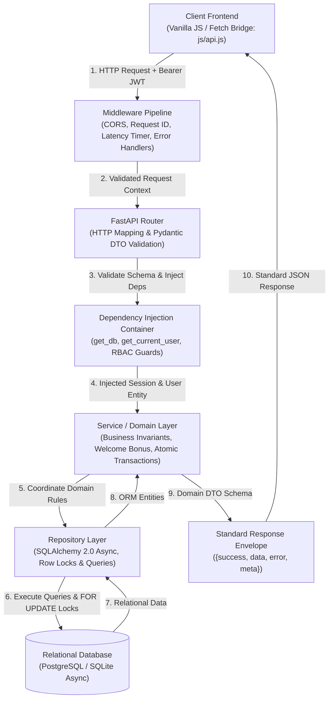

# 🚗 IJDrives — Multi-Modal Transport Marketplace

<div align="center">

[](https://fastapi.tiangolo.com)
[](https://www.python.org)
[](https://www.sqlalchemy.org)
[](https://docs.pydantic.dev)
[](https://www.docker.com)
[](#-the-one-flow-path-architecture)

**A modern, production-grade transport marketplace connecting Nigerian commuters across Land, Rail, Sea, and Air through a unified discovery, digital wallet, and ticket booking engine.**

[Explore Live API Docs](#-api-endpoints-reference) • [Quickstart Guide](#-quickstart-guide) • [Architecture](#-the-one-flow-path-architecture) • [Testing](#-automated-testing)

</div>

---

## 📖 Table of Contents
- [Overview](#-overview)
- [The "One Flow Path" Architecture](#-the-one-flow-path-architecture)
- [Key Features](#-key-features)
- [Technology Stack](#-technology-stack)
- [Project Structure](#-project-structure)
- [API Endpoints Reference](#-api-endpoints-reference)
- [Quickstart Guide](#-quickstart-guide)
  - [Prerequisites](#1-prerequisites)
  - [Backend Setup (FastAPI)](#2-backend-setup-fastapi)
  - [Database Seeding](#3-database-seeding)
  - [Frontend Setup](#4-frontend-setup)
  - [Demo User Credentials](#5-demo-user-credentials)
- [Automated Testing](#-automated-testing)
- [Docker Deployment](#-docker-deployment)
- [Software Engineering Principles](#-software-engineering-principles)
- [License & Credits](#-license--credits)

---

## 🌟 Overview

**IJDrives** is an integrated transport discovery and reservation platform built specifically for Nigerian transit hubs (Lagos, Abuja, Port Harcourt, Kano, Ibadan, Enugu, Calabar, Warri, etc.).

It solves the problem of fragmented transport operators by providing:
1. **Multi-Modal Route Discovery**: Single search interface covering interstate luxury buses, Nigerian Railway Corporation (NRC) trains, coastal & inland ferries, and domestic flights.
2. **Interactive Map-Based Visualizer**: Powered by Leaflet and Stadia Maps, rendering exact coordinate lines, stations, and waypoints across Nigeria.
3. **Enterprise FastAPI Backend**: Replacing brittle client-side storage with an asynchronous, strictly typed REST API backed by SQLAlchemy 2.0 and Pydantic v2.
4. **Digital Wallet & Ledger**: Complete financial accounting with welcome bonuses, deposit validation, and atomic row-locked debits preventing double-spending.

---

## 🏛 The "One Flow Path" Architecture

To maintain strict maintainability, separation of concerns, and predictability, every request in IJDrives adheres to **one strict, unidirectional flow path**:



### Standard Unified Response Envelope

Every endpoint in the system outputs an identical response contract:

#### Success Response (`200 OK`, `201 Created`)
```json
{
  "success": true,
  "data": { ... },
  "error": null,
  "meta": {
    "timestamp": "2026-11-04T14:30:00Z",
    "request_id": "req_8f1a2c9b4e"
  }
}
```

#### Error Response (`400`, `401`, `403`, `404`, `409`, `422`)
```json
{
  "success": false,
  "data": null,
  "error": {
    "code": "INSUFFICIENT_WALLET_BALANCE",
    "message": "Insufficient wallet balance. You have ₦1,500.00 but require ₦9,500.00.",
    "details": [
      {
        "current_balance": 1500.0,
        "required_amount": 9500.0,
        "shortfall": 8000.0
      }
    ]
  },
  "meta": {
    "timestamp": "2026-11-04T14:30:00Z",
    "request_id": "req_8f1a2c9b4e"
  }
}
```

---

## ⚡ Key Features

- **Multi-Modal Catalog**:
  - 🚌 **Land**: Premium interstate bus operators (GUO, ABC Transport, Young Shall Grow, Chisco, Peace Mass Transit).
  - 🚆 **Rail**: Modern standard gauge rail routes (Lagos-Ibadan, Abuja-Kaduna, Warri-Itakpe).
  - ⛴ **Sea**: Coastal waterways and passenger ferries (Lagos Ferry Service, Calabar-Oron Waterways).
  - ✈️ **Air**: Domestic airlines (Air Peace, Ibom Air, Overland Airways, Green Africa).
- **Zero Double-Spending Financial Engine**:
  - Atomic database transactions with row-level locking (`SELECT ... FOR UPDATE`).
  - Automatic `₦500.00` welcome credit on registration.
  - Top-up bounds checking (min ₦500.00, max ₦500,000.00).
  - Immutable audit trail recording every credit, deposit, and trip payment.
- **Stateless Defense-in-Depth Security**:
  - Passwords hashed using server-side `bcrypt` with cryptographic salt.
  - Stateless JWT access tokens passed via `Authorization: Bearer <token>` headers.
  - Sanitized inputs through strict Pydantic v2 schemas.
  - CORS security policies restricting unapproved origins.
- **4-Step Booking Lifecycle**:
  - `Step 1`: Route & operator summary with map preview.
  - `Step 2`: Passenger contact details (auto-filled for authenticated users).
  - `Step 3`: Visual seat selection grid (buses/trains) or cabin class selector (air/sea).
  - `Step 4`: Review & atomic 1-click payment from user wallet with instant receipt generation.
- **User Dashboard**:
  - Time-aware greetings and live financial statistics (wallet balance, trips booked, total expenditure).
  - Searchable bookings table and real-time transaction ledger.

---

## 🛠 Technology Stack

| Domain | Technology / Tool | Purpose |
| :--- | :--- | :--- |
| **Backend Framework** | **FastAPI** (Python 3.10+) | High-throughput asynchronous REST API & OpenAPI docs |
| **Data Validation** | **Pydantic v2** & **pydantic-settings** | Strict type validation, DTOs, and environment management |
| **ORM & Database** | **SQLAlchemy 2.0 Async** | Async queries, Unit of Work, and ACID transaction boundaries |
| **Databases** | **PostgreSQL** / **aiosqlite** | Relational storage for production and zero-setup local dev |
| **Authentication** | **python-jose** + **Passlib (Bcrypt)** | Stateless JWT token issuance and password hashing |
| **Frontend UI** | **Vanilla HTML5, CSS3, JavaScript** | Fast, lightweight UI without heavy node build steps |
| **API Client Bridge** | **`js/api.js`** | Unified browser HTTP client enforcing the One Flow Path |
| **Mapping Engine** | **Leaflet** + **Stadia Maps API** | Interactive dark/light responsive vector mapping |
| **Testing** | **pytest** + **pytest-asyncio** + **HTTPX** | Comprehensive async test suite |
| **Containerization** | **Docker** & **Docker Compose** | Multi-stage production container build & orchestrated Postgres |

---

## 📁 Project Structure

```text
Final project/ijdrives_fixed/
├── backend/
│   ├── app/
│   │   ├── api/
│   │   │   ├── deps.py               # Dependency injection (get_db, get_current_user)
│   │   │   └── v1/
│   │   │       ├── router.py         # Root v1 router assembly
│   │   │       └── endpoints/
│   │   │           ├── auth.py       # Register, login, profile (/api/v1/auth)
│   │   │           ├── bookings.py   # Atomic ticket reservations (/api/v1/bookings)
│   │   │           ├── health.py     # System & database health probe (/api/v1/health)
│   │   │           ├── transport.py  # Route discovery & providers (/api/v1/transport)
│   │   │           └── wallet.py     # Balance, deposits, ledger (/api/v1/wallet)
│   │   ├── core/
│   │   │   ├── config.py             # Pydantic Settings & environment variables
│   │   │   ├── database.py           # Async engine, sessionmaker & Base metadata
│   │   │   ├── exceptions.py         # Standard domain exception classes
│   │   │   ├── middleware.py         # Request context, timing & global error handlers
│   │   │   └── security.py           # Bcrypt hashing & JWT token management
│   │   ├── data_seeds/
│   │   │   └── seed_initial_data.py  # Automated DB seeder from JSON catalogs
│   │   ├── models/                   # Declarative SQLAlchemy 2.0 ORM models
│   │   │   ├── base.py               # UUIDPrimaryKey & Timestamp mixins
│   │   │   ├── booking.py            # Booking model
│   │   │   ├── transport.py          # Provider & Route models
│   │   │   ├── user.py               # User model
│   │   │   └── wallet.py             # Wallet & WalletTransaction models
│   │   ├── repositories/             # Data Access Layer (CRUD & Row Locks)
│   │   │   ├── base.py               # Generic async repository pattern
│   │   │   ├── booking_repo.py
│   │   │   ├── transport_repo.py
│   │   │   ├── user_repo.py
│   │   │   └── wallet_repo.py
│   │   ├── schemas/                  # Pydantic v2 Request/Response DTOs
│   │   │   ├── booking.py
│   │   │   ├── common.py             # StandardResponse[T] envelope & metadata
│   │   │   ├── transport.py
│   │   │   ├── user.py
│   │   │   └── wallet.py
│   │   ├── services/                 # Business Logic & Orchestration
│   │   │   ├── auth_service.py
│   │   │   ├── booking_service.py    # Atomic reservation & wallet deduction
│   │   │   ├── transport_service.py
│   │   │   └── wallet_service.py
│   │   └── main.py                   # FastAPI application factory & lifespan
│   ├── tests/                        # Async Pytest suite
│   │   ├── conftest.py               # Test database fixtures & HTTP client
│   │   ├── test_auth.py
│   │   ├── test_bookings.py
│   │   └── test_wallet.py
│   ├── .env.example
│   ├── Dockerfile
│   ├── docker-compose.yml
│   └── requirements.txt
├── css/                              # Theme, components, and page styles
├── data/                             # Raw Nigerian transport catalog JSONs
│   ├── air.json
│   ├── land.json
│   ├── providers.json
│   ├── rail.json
│   └── sea.json
├── js/                               # Frontend scripts
│   ├── api.js                        # Unified API Bridge connecting UI to FastAPI
│   ├── auth.js                       # Session & auth UI updates
│   ├── booking-page.js               # 4-step booking workflow
│   ├── config.js                     # Global frontend configurations
│   ├── dashboard-page.js             # User dashboard population
│   ├── maps.js                       # Leaflet map rendering
│   └── wallet.js                     # Wallet UI controls
├── index.html                        # Homepage & route search
├── dashboard.html                    # User dashboard
├── booking.html                      # Checkout & reservation
├── confirm.html                      # Ticket & receipt view
├── wallet.html                       # Wallet top-up & transactions
├── land.html, rail.html, sea.html, air.html # Mode-specific catalog browsers
└── login.html, signup.html           # Authentication pages
```

---

## 📡 API Endpoints Reference

| Method | Endpoint | Description | Auth Required |
| :--- | :--- | :--- | :---: |
| `GET` | `/api/v1/health` | Health & database connectivity probe | No |
| `POST` | `/api/v1/auth/register` | Register new user + auto-credit ₦500 bonus | No |
| `POST` | `/api/v1/auth/login` | Authenticate user & issue signed JWT | No |
| `GET` | `/api/v1/auth/me` | Fetch active user profile & live wallet balance | **Yes** |
| `GET` | `/api/v1/wallet` | Fetch wallet balance and transaction ledger | **Yes** |
| `POST` | `/api/v1/wallet/deposit` | Top up wallet balance (₦500 to ₦500,000) | **Yes** |
| `GET` | `/api/v1/transport/routes` | Search routes with filters (mode, origin, fare, sort) | No |
| `GET` | `/api/v1/transport/routes/{id}` | Get specific route details with provider metadata | No |
| `GET` | `/api/v1/transport/providers` | List all certified transport operators | No |
| `GET` | `/api/v1/transport/providers/{id}` | Get specific provider details | No |
| `POST` | `/api/v1/bookings` | **Atomic booking**: deducts fare, decrements seat, creates ticket | **Yes** |
| `GET` | `/api/v1/bookings/my` | List all bookings belonging to current user | **Yes** |
| `GET` | `/api/v1/bookings/{ref}` | Retrieve booking receipt by reference (`IJ-XXXXXXXX`) | No |

---

## 🚀 Quickstart Guide

### 1. Prerequisites
- **Python**: Version `3.10` or higher
- **Web Browser**: Chrome, Firefox, Edge, or Safari

---

### 2. Backend Setup (FastAPI)

1. Open PowerShell or Terminal and navigate to the backend directory:
   ```bash
   cd "Final project/ijdrives_fixed/backend"
   ```

2. Create and activate a Python virtual environment:
   ```bash
   # Windows PowerShell:
   python -m venv .venv
   .venv\Scripts\Activate.ps1

   # Linux / macOS:
   python3 -m venv .venv
   source .venv/bin/activate
   ```

3. Install pinned production dependencies:
   ```bash
   pip install -r requirements.txt
   ```

4. Create your local environment configuration:
   ```bash
   # Windows:
   copy .env.example .env

   # Linux / macOS:
   cp .env.example .env
   ```

---

### 3. Database Seeding

Initialize the database schema and populate Nigerian routes across Land, Rail, Sea, and Air directly from the JSON files:

```bash
python -m app.data_seeds.seed_initial_data
```

*(Note: The database is also self-bootstrapping and will automatically seed missing data during server startup).*

---

### 4. Running the Development Server

Start the FastAPI application with live hot-reloading:

```bash
uvicorn app.main:app --reload --host 127.0.0.1 --port 8000
```

Once running, access:
- **Interactive Swagger UI**: [http://127.0.0.1:8000/docs](http://127.0.0.1:8000/docs)
- **ReDoc Interactive Documentation**: [http://127.0.0.1:8000/redoc](http://127.0.0.1:8000/redoc)
- **Diagnostics Health Check**: [http://127.0.0.1:8000/api/v1/health](http://127.0.0.1:8000/api/v1/health)

---

### 5. Frontend Setup

Serve the frontend files using any local HTTP static server or the VS Code Live Server extension:

```bash
# Using Python's built-in HTTP server:
cd "Final project/ijdrives_fixed"
python -m http.server 3000
```

Visit [http://localhost:3000](http://localhost:3000) in your browser. The frontend will automatically communicate with the FastAPI backend at `http://127.0.0.1:8000/api/v1`.

---

### 6. Demo User Credentials

The database seeder provisions a pre-funded test account ready for instant testing:

| Attribute | Demo Credential |
| :--- | :--- |
| **Email** | `demo@ijdrives.ng` |
| **Password** | `password123` |
| **Starting Balance** | **₦15,000.00** |

---

## 🧪 Automated Testing

The backend includes a comprehensive async test suite covering authentication, duplicate detection, wallet limits, and atomic concurrency:

```bash
cd backend
pytest -v
```

### Test Coverage Highlights:
- `test_register_success`: Validates account creation & automatic ₦500 welcome credit.
- `test_register_duplicate_email`: Verifies 409 conflict on duplicate registrations.
- `test_login_success` & `test_login_invalid_password`: Validates password hashing and JWT issuance.
- `test_wallet_deposit_success` & `test_wallet_deposit_below_minimum`: Validates ₦500 - ₦500,000 bounds.
- `test_create_booking_atomic_success`: Verifies route locking, seat decrement, wallet debit, and ticket creation.
- `test_booking_insufficient_funds`: Confirms transaction rollback and exact shortfall error calculation.

---

## 🐳 Docker Deployment

To run the complete production stack (FastAPI app + PostgreSQL database) using Docker:

```bash
cd backend
docker compose up -d --build
```

The containerized backend will be accessible at [http://localhost:8000](http://localhost:8000) with automatic health probes.

---

## 📐 Software Engineering Principles

| Principle | Realization in IJDrives |
| :--- | :--- |
| **Single Responsibility (SRP)** | **Routers** handle HTTP mapping; **Services** enforce domain invariants; **Repositories** execute SQL; **Schemas** enforce type contracts. |
| **Open / Closed (OCP)** | New transport modes and payment adapters can be integrated without modifying core transaction coordinators. |
| **Dependency Inversion (DIP)** | Services depend on abstract repositories injected via FastAPI's `Depends()` container, facilitating seamless test mocking. |
| **Interface Segregation (ISP)** | Distinct, specialized Pydantic models for registration, login, profile view, and admin summaries. |
| **ACID Guarantees** | Row-level locking on wallet balances and seats guarantees zero race conditions or double-spending under concurrent traffic. |
| **Defensive Security** | Zero plain-text credentials, salted bcrypt hashing, short-lived signed tokens, and strict CORS policies. |

---

## 📄 License & Credits

- **Product Design & Engineering**: GroTec / Ikedi
- **Frontend Assets & Frameworks**: Font Awesome 6, Leaflet, Stadia Maps, OpenMapTiles
- **Backend Architecture**: FastAPI, SQLAlchemy 2.0, Pydantic v2

> *Disclaimer: This platform is configured for demonstration purposes. Financial transactions and bookings operate in a sandbox environment.*
